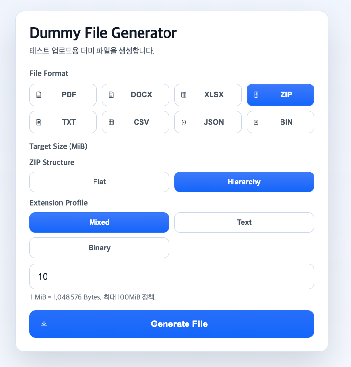

# Dummy File Generator

원하는 파일 포맷과 목표 용량을 지정해 테스트용 더미 파일을 생성하고 내려받는 웹 도구입니다.
시드(seed) 기반 재현성과 목표 바이트 맞춤 모드를 제공해 업로드·성능 테스트 데이터를 손쉽게 준비할 수 있습니다.

**기술 스택:** Next.js 16 · React 19 · TypeScript · Tailwind CSS · Zod · JSZip · Vitest · Playwright



## 주요 기능

- **지원 포맷 및 용량 모드:** `pdf`, `docx`, `xlsx`, `zip`, `txt`, `csv`, `json`, `bin` 포맷 지원, 목표 바이트 일치(`exact`) 및 이상(`at_least`) 모드 제공
- **생성 정책 및 제한:** 파일 크기 `256B`~`100MiB`(50MiB 초과 시 Blob 권장), IP 기준 분당 20회 요청 제한, 생성 파일 메모리 저장소 30분 TTL 보관
- **REST API 제공:** `POST /api/generate`, `GET /api/download/:id`, `POST /api/blob/sign`(스텁) 엔드포인트 지원

## 요구 사항

- [mise](https://mise.jdx.dev/) — Node.js 버전은 [`mise.toml`](./mise.toml)에 고정되어 있으며 `mise`가 설치합니다.

## 빠른 시작

```bash
mise trust          # 최초 1회, mise.toml 검토 후 신뢰
mise run bootstrap  # 고정된 Node.js 설치 + 의존성 설치
mise run dev        # 개발 서버 실행
```

배포 데모는 [Dummy File Generator 웹페이지](https://tool-hubdummy-file-generator.vercel.app/)에서 확인할 수 있습니다.

## 주요 명령

| 명령 | 설명 |
| --- | --- |
| `mise run dev` | 개발 서버 실행 |
| `mise run test` | Vitest 테스트 실행 |
| `mise run lint` | ESLint 검사 |
| `mise run typecheck` | TypeScript 타입 검사 |
| `mise run build` | 프로덕션 빌드 |
| `mise run test-e2e` | Playwright E2E 테스트 실행 |
| `mise run check` | 테스트·린트·타입체크·빌드·E2E 통합 검증 |

전체 task 목록은 `mise tasks`로 확인할 수 있습니다.

## 문서

- [API 명세](./docs/API.md)
- [테스트 플랜](./tests/TEST_PLAN.md)
- [프로젝트 기여자 가이드](./docs/contributor-guide.md)
- [루트 문서 인덱스](../docs/README.md)

## 기여

변경 전 [기여자 가이드](./docs/contributor-guide.md)를 확인해 주세요.
