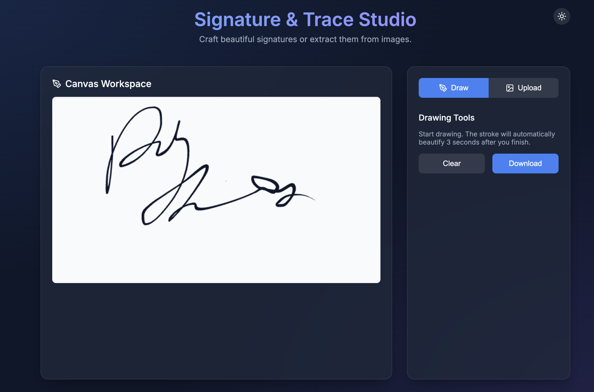
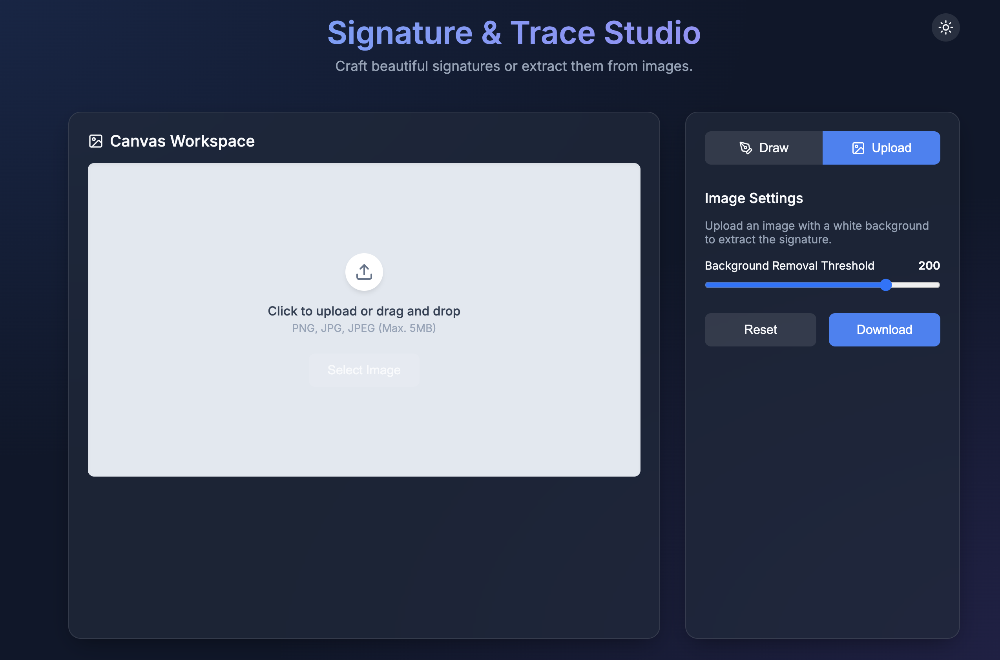

# Sign Maker

마우스·터치 드로잉이나 자필 서명 사진에서 배경이 투명한 서명 이미지를 만드는 웹 도구입니다.
획 보정과 배경 투명도 임계값 조절을 브라우저에서 바로 처리하고 PNG 파일로 내려받을 수 있습니다.

**기술 스택:** React 19 · TypeScript · Vite · Tailwind CSS · perfect-freehand · Vitest · Playwright




## 주요 기능

- **드로잉 캔버스:** 입력 속도에 반응하는 브러시 렌더링과 자동 곡선 보정
- **이미지 배경 제거:** 자필 서명 이미지 업로드 후 임계값 슬라이더로 배경 투명화
- **내보내기 및 테마:** 투명 배경 PNG 다운로드 및 라이트·다크 테마 전환

## 요구 사항

- [mise](https://mise.jdx.dev/) — Node.js 버전은 [`mise.toml`](./mise.toml)에 고정되어 있으며 `mise`가 설치합니다.

## 빠른 시작

```bash
mise trust          # 최초 1회, mise.toml 검토 후 신뢰
mise run bootstrap  # 고정된 Node.js 설치 + 의존성 설치
mise run dev        # 개발 서버 실행
```

배포 데모는 [Sign Maker 웹페이지](https://tool-hubsign-maker.vercel.app/)에서 확인할 수 있습니다.

## 주요 명령

| 명령 | 설명 |
| --- | --- |
| `mise run dev` | 개발 서버 실행 |
| `mise run test` | Vitest 테스트 실행 |
| `mise run lint` | ESLint 검사 |
| `mise run typecheck` | TypeScript 타입 검사 |
| `mise run build` | 프로덕션 빌드 |
| `mise run test-e2e` | Playwright E2E 테스트 실행 |
| `mise run check` | 테스트·린트·타입체크·빌드·E2E 통합 검증 |

전체 task 목록은 `mise tasks`로 확인할 수 있습니다.

## 문서

- [프로젝트 기여자 가이드](./docs/contributor-guide.md)
- [루트 문서 인덱스](../docs/README.md)

## 기여

변경 전 [기여자 가이드](./docs/contributor-guide.md)를 확인해 주세요.
