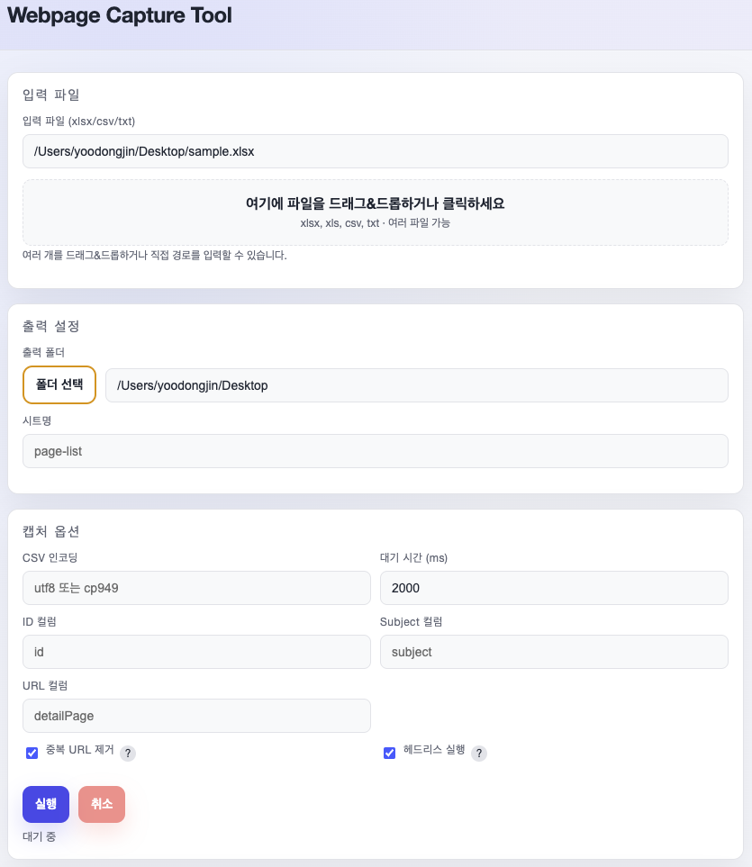

# Webpage Capture Tool

URL 목록을 순회하며 전체 페이지 스크린샷을 촬영·편집·내보내는 CLI 및 Electron 데스크톱 애플리케이션입니다.
`npm workspaces` 기반으로 코어 캡처 엔진(`packages/core`), CLI(`packages/cli`), Electron 워크벤치(`apps/electron`)를 함께 구성했습니다.

**기술 스택:** Electron · Node.js · JavaScript (CommonJS) · Playwright · Vitest



## 주요 기능

- **일괄 및 수동 캡처:** 스프레드시트(`.xlsx`, `.csv`) 또는 텍스트 목록 기반 URL 순회 촬영, 대기 시간·탐색 깊이(`depth`)·헤드리스 옵션 제어
- **DOM 규칙 및 이미지 편집:** 캡처 전 DOM 요소 숨김·강조 프리뷰, 촬영 이미지 크롭·블러·주석 편집
- **문서 내보내기:** 촬영 결과를 Markdown, Word(`.docx`), PowerPoint(`.pptx`) 자산으로 내보내기

## 요구 사항

- [mise](https://mise.jdx.dev/) — Node.js 버전은 [`mise.toml`](./mise.toml)에 고정되어 있으며 `mise`가 설치합니다.

## 빠른 시작

```bash
mise trust          # 최초 1회, mise.toml 검토 후 신뢰
mise run bootstrap  # 고정된 Node.js 설치 + 의존성 설치
mise run setup      # Playwright Chromium 브라우저 설치 (최초 1회)
mise run start      # Electron 데스크톱 앱 실행
```

CLI로 바로 실행하려면 아래와 같이 입력합니다.

```bash
mise run cli -- --file docs/sample-files/sample.xlsx --wait 2500
```

## 주요 명령

| 명령 | 설명 |
| --- | --- |
| `mise run start` | Electron 데스크톱 앱 실행 |
| `mise run cli` | CLI 캡처 도구 실행 |
| `mise run setup` | Playwright 브라우저 설치 |
| `mise run test` | Vitest 단위 테스트 실행 |
| `mise run lint` | 스크립트 구문 및 린트 검사 |
| `mise run check` | 테스트 및 린트 통합 검증 |
| `mise run build-mac` | macOS 패키지(`.dmg`) 빌드 |
| `mise run build-win` | Windows 패키지(`.nsis`) 빌드 |

전체 task 목록은 `mise tasks`로 확인할 수 있습니다.

## 문서

- [수동 캡처 워크벤치 사용 가이드](./docs/manual-capture-workbench-user-guide.md)
- [프로젝트 기여자 가이드](./docs/contributor-guide.md)
- [루트 문서 인덱스](../docs/README.md)

## 기여

변경 전 [기여자 가이드](./docs/contributor-guide.md)를 확인해 주세요.
